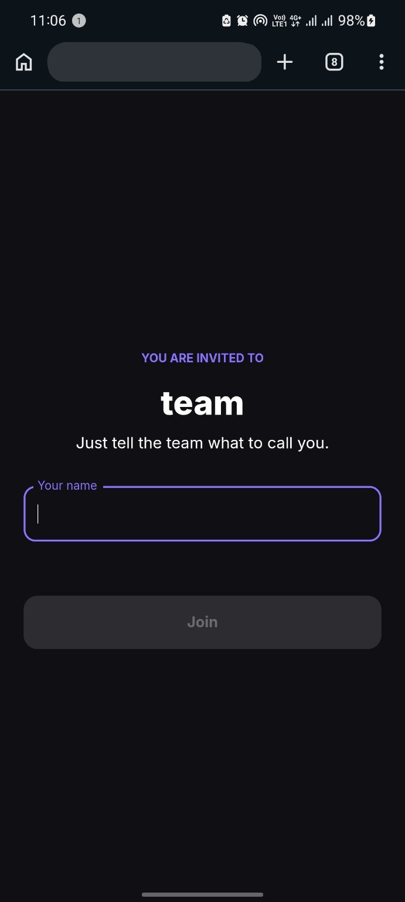
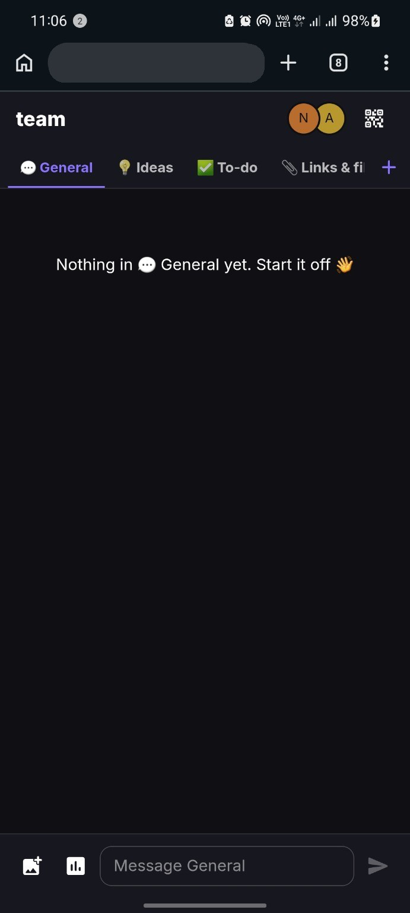
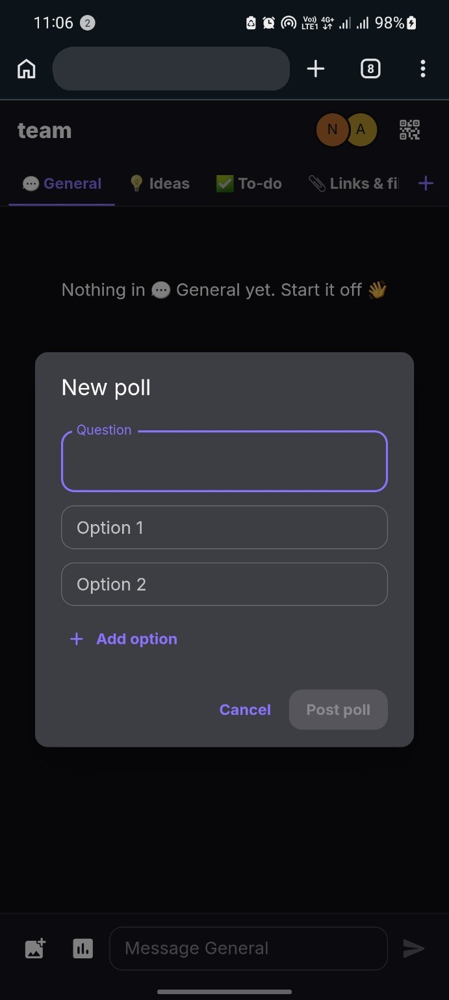
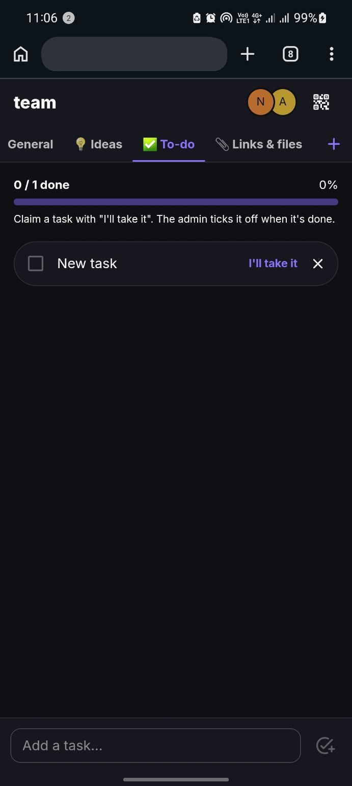
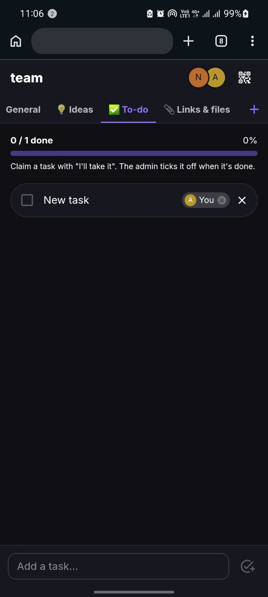
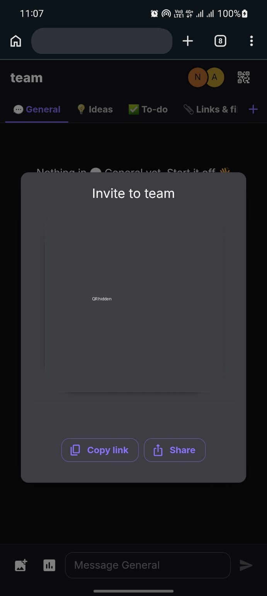

# Assemblie

Assemblie is a mobile-first web app for temporary team rooms. A team creator starts a room, shares a QR invite, and everyone joins with only a display name. It is designed for hackathons, workshops, classrooms, events, and any short session where people need a shared space fast.

## Project Story

Assemblie came from a real team problem: even as individual members of the same team, we kept losing time trying to organize people, tasks, links, and quick decisions in one place. We built the app to make temporary collaboration rooms simple enough for anyone to join by QR code and useful enough for a team to actually coordinate.

The project won second place at Commit Athens, an ElevenLabs-sponsored hackathon. It was developed by the brilliant minds of Mellon Technologies, with just enough chaos in the room to prove the product needed to exist.

## Live App

- Production: https://assemblie.link
- Firebase fallback: https://teamassembly-853e4.web.app

## Highlights

- QR-based team invites for fast in-person onboarding
- No visible login flow, using silent Firebase anonymous auth
- Real-time chat with text, compressed image messages, link previews, and polls
- Built-in channels for general chat, ideas, tasks, links, and casual discussion
- Custom channels with chat or checklist mode
- Shared checklist boards for assigning and completing tasks
- Admin controls for renaming teams, removing or banning members, deleting channels, and deleting teams
- Mobile-first PWA setup with installable app icons and manifest

## App Screenshots

| Join A Team | Team Chat | Create Polls |
|---|---|---|
|  |  |  |

| Claim Tasks | Assign Tasks | Invite By QR |
|---|---|---|
|  |  |  |

## How It Works

1. The creator enters a team name and their display name.
2. Assemblie creates a Firestore-backed team room and opens a share screen.
3. Other participants scan the QR code, enter a unique display name, and join the room.
4. The team collaborates in channels using chat, images, polls, links, and task boards.
5. The admin can manage members, channels, and the full team lifecycle.

## Tech Stack

- React 19
- TypeScript
- Vite
- Material UI
- React Router
- Firebase Auth
- Cloud Firestore
- Firebase Hosting
- `qrcode.react`

## Local Development

```bash
cd app
npm install
npm run dev
```

The Vite development server will print a local URL, usually `http://localhost:5173`.

## Build And Lint

```bash
cd app
npm run build
npm run lint
```

## Firebase Notes

Firebase client configuration lives in `app/src/firebase.ts`. The config is public by design for Firebase web apps; access control is enforced by `firestore.rules`.

Firestore is used for teams, members, channels, messages, polls, bans, and todo items. Image messages are compressed in the browser and stored inline because the project currently avoids Firebase Storage billing requirements.

## Project Structure

```text
app/
  public/              PWA icons, manifest, and service worker
  src/
    components/        Reusable UI components
    pages/             Home, share, and team room screens
    api.ts             Firestore reads, writes, and subscriptions
    firebase.ts        Firebase app configuration
    image.ts           Client-side image compression
firestore.rules        Firestore security rules
firebase.json          Firebase Hosting configuration
```

## Commit Message Guidance

Use clear, action-based commit messages:

- `Improve README project overview`
- `Add checklist channel UI`
- `Add admin member controls`
- `Fix unique name validation`
- `Update PWA icons and manifest`

Avoid placeholder messages like `hello`, `final`, or unclear typo-heavy notes. Existing GitHub commits can only be renamed by rewriting history, so prefer clean messages for future commits unless the branch is intentionally being rebased.
